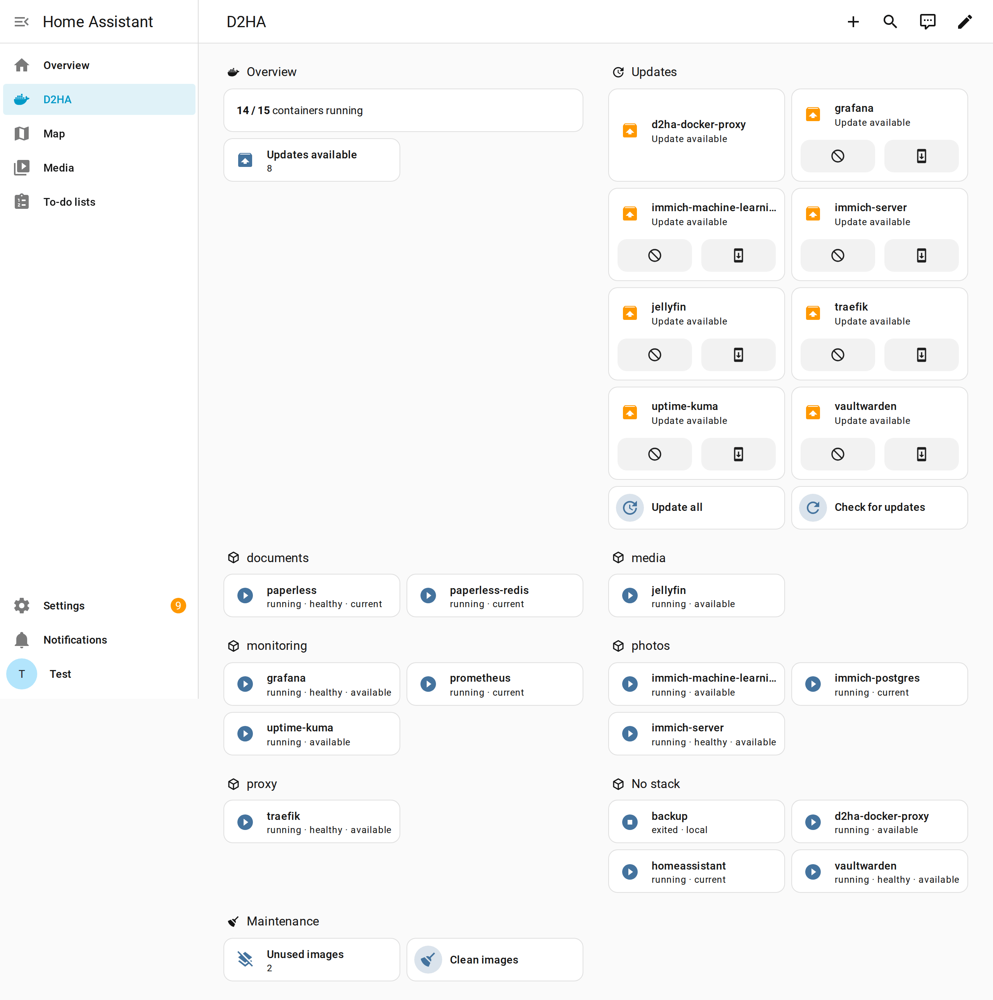
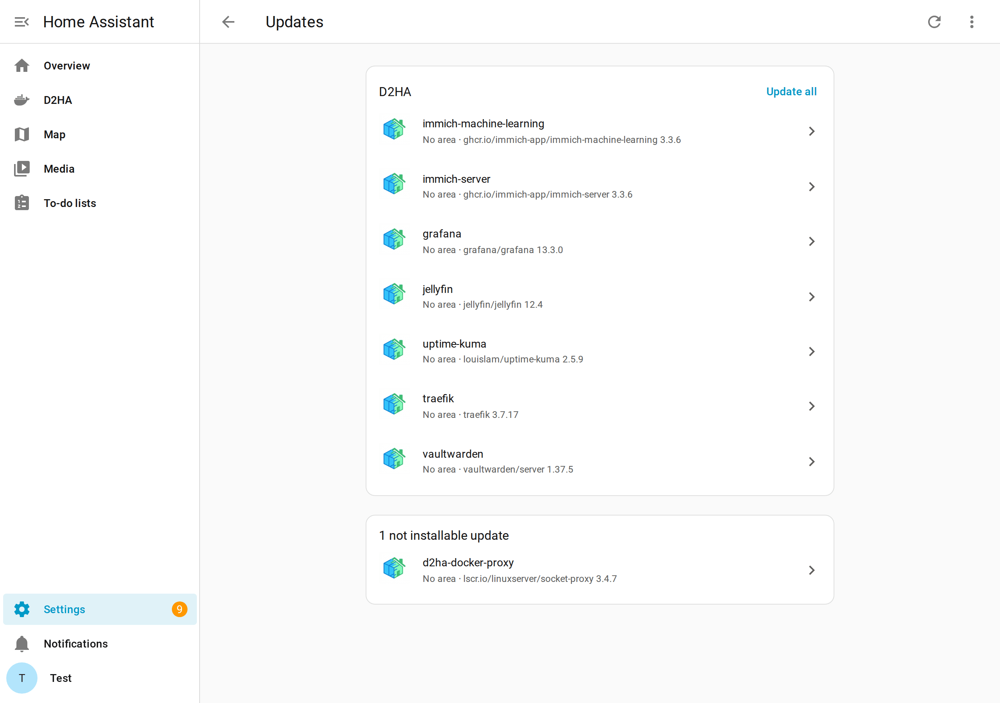
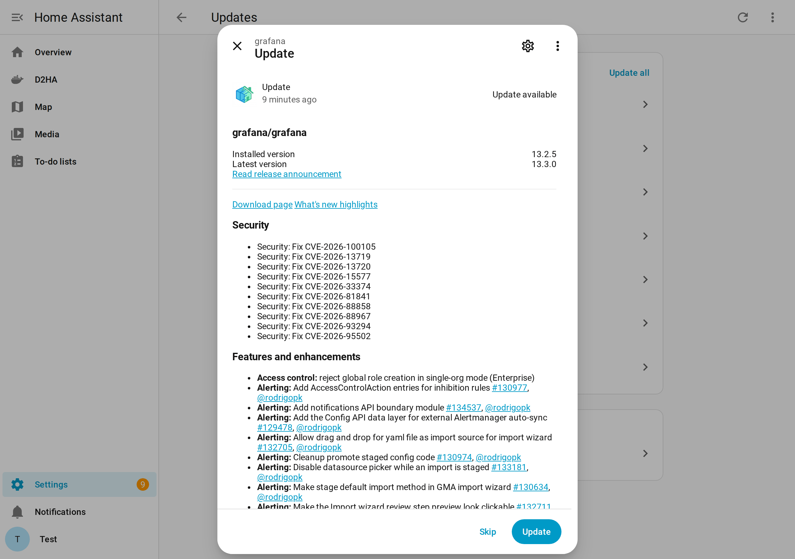

# D2HA for Home Assistant

The Home Assistant integration for [D2HA](https://github.com/Arborae/docker2homeassistant):
know which containers have updates, read the release notes and update them — from your
dashboards and automations.



## What you get

One device for every container you choose in D2HA (named after the container,
under the **D2HA** server device), each with:

- an **update entity** — installed and latest version, release notes of the exact new
  version, breaking changes flag, live progress while updating, *Install* to run the safe
  update (only when D2HA allows it);
- a **state sensor** — running, exited, health, image, stack.

Plus server-wide entities:

- sensors: **updates available**, **containers running**, **unused images**;
- buttons: **Check for updates**, **Update all**, **Clean images** (the last two are hidden
  when D2HA runs in read-only mode).

Updates started from the D2HA web interface show their progress here too, and an
"updates available" sensor makes Telegram or mobile notifications a two-line automation.





## Dashboard

The integration ships a dashboard strategy: **Settings → Dashboards → Add dashboard →
D2HA** creates a page that builds itself — the counters, the pending updates with
release notes and install actions, the containers grouped by stack with health and
update status, and the maintenance actions. It is rebuilt from the live entities every
time it opens, with built-in cards only, in English and Italian, and needs nothing else
installed. With more than one D2HA server configured, the dashboard has one view each.
More in [the dashboard guide](https://arborae.github.io/docker2homeassistant/guide/dashboard/).

## Installation

Requires Home Assistant 2026.8 or later.

[](https://my.home-assistant.io/redirect/marketplace_repository/?owner=arborae&repository=ha-d2ha&category=integration)

1. Install the integration. The link above opens it in the Marketplace (or in HACS) and
   offers to add it.
   - **Home Assistant 2026.11 or later:** open **Settings → Marketplace → Add from
     link**, enter `https://github.com/arborae/ha-d2ha` with type **Integration** (the
     first time, the Marketplace asks you to connect GitHub), then **Install** and
     **Restart Home Assistant**.
   - **Home Assistant 2026.8 to 2026.10:** in HACS, add `https://github.com/arborae/ha-d2ha`
     as a custom repository of type **Integration**, download **D2HA** and restart Home
     Assistant.
2. In D2HA, open **Settings → Home Assistant** and create an API token (shown once).
3. In Home Assistant, **Settings → Devices & services → Add integration → D2HA**: enter the
   address of D2HA (for example `http://127.0.0.1:12021` when they share a host) and the
   token.

Choose which containers appear in Home Assistant in D2HA, **Settings → Home Assistant**.
The full guide, with screenshots: [D2HA in Home
Assistant](https://arborae.github.io/docker2homeassistant/guide/home-assistant/).

## Notes

- The integration polls D2HA every 60 seconds (every 5 seconds while an update job runs)
  through the `/api/v1` API with the bearer token; the contract is
  [API.md](https://github.com/Arborae/docker2homeassistant/blob/main/API.md).
- Everything stays on your network: the integration only talks to your D2HA.
- Every container is its own device, named after the container. Devices have no area
  on their own: assign one (the device page, pencil icon) and Settings → Updates
  groups the rows by it.

## Development

```bash
python3.14 -m venv .venv && .venv/bin/pip install -r requirements_test.txt
.venv/bin/pytest -q
```

The rules for contributions and for the AI assistants working on this repository are in
[AGENTS.md](AGENTS.md).

## License

GNU GPL v3.0, see [LICENSE](LICENSE). A project by [Arborae](https://github.com/Arborae).
